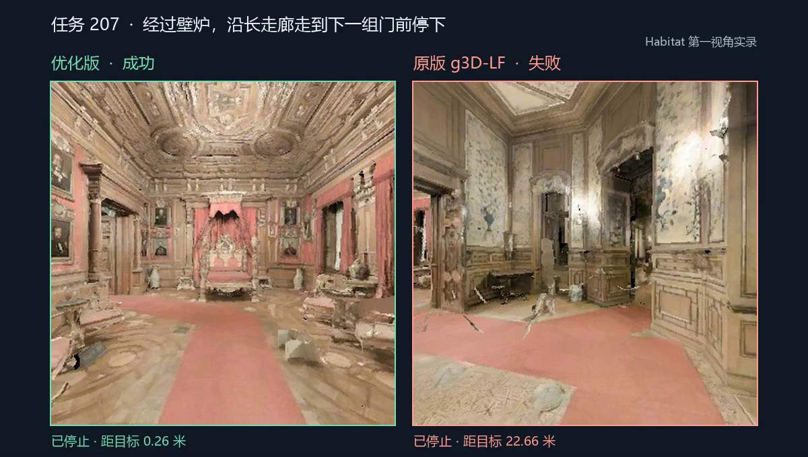
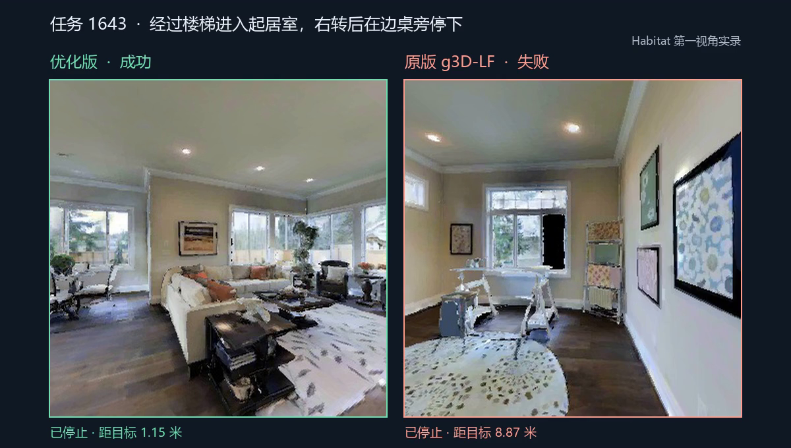

# World-Model-Assisted Vision-and-Language Navigation

This project extends the panoramic [g3D-LF](https://github.com/MrZihan/g3D-LF) navigation policy so it can learn from complete routes and adapt how much it trusts predicted views when choosing its next action.

## Approach

- **GRPO post-training.** Sample multiple rollouts from the same start and instruction. Use success, path efficiency, and distance to the goal to compute group-relative advantages. A clipped objective and a KL penalty constrain policy updates.
- **Reliability fusion.** A 449-parameter MLP uses 12 statistics from candidate scores and predicted visual features to adjust how much the lookahead branch influences waypoint and stop decisions. The gate is initialized with candidate-ranking supervision and tuned on logged returns. The 3D feature field stays frozen.

## Results

R2R-CE `val_unseen`, panoramic Habitat simulation. Both saved evaluations cover the same 1,839 episodes across 11 scenes. SR is success rate. SPL weights successful episodes by path efficiency.

| Model | SR ↑ | SPL ↑ |
| --- | ---: | ---: |
| Original g3D-LF, released checkpoint | 60.20% | 50.85% |
| GRPO + reliability fusion | **61.45%** | **51.95%** |
| Difference | **+1.25 pp** | **+1.10 pp** |

These are point estimates from two historical evaluation runs of the complete policies.

## Demo videos

Three matched episodes where the original policy failed and the optimized policy succeeded. Each clip animates the optimized model's recorded trajectory and shows the original model's final distance from its evaluation log.

| Episode and goal | Original final distance | Optimized final distance | Video |
| --- | ---: | ---: | --- |
| **207** · Follow the corridor to the next doors | 20.68 m · fail | **0.26 m · success** |  |
| **1643** · Stop by the end table in the great room | 8.87 m · fail | **1.15 m · success** |  |

## Code

The repository contains the PyTorch method components. Environment setup, simulator rollouts, and checkpoints are external dependencies. See [integration notes](docs/integration.md) for the tensor interface and evaluation setup.

- [GRPO objectives](vln_policy/grpo.py)
- [Candidate features, reliability gate, and offline tuning objective](vln_policy/reliability.py)

## Acknowledgments

The navigation backbone is from [g3D-LF (CVPR 2025)](https://openaccess.thecvf.com/content/CVPR2025/papers/Wang_g3D-LF_Generalizable_3D-Language_Feature_Fields_for_Embodied_Tasks_CVPR_2025_paper.pdf). The online post-training recipe is adapted from [ETP-R1](https://arxiv.org/abs/2512.20940). The research replays use navigation results from Matterport3D scenes. See the [Matterport3D data terms](https://kaldir.vc.in.tum.de/matterport/MP_TOS.pdf).
